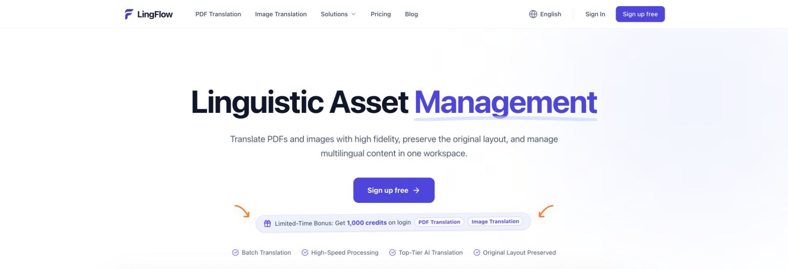
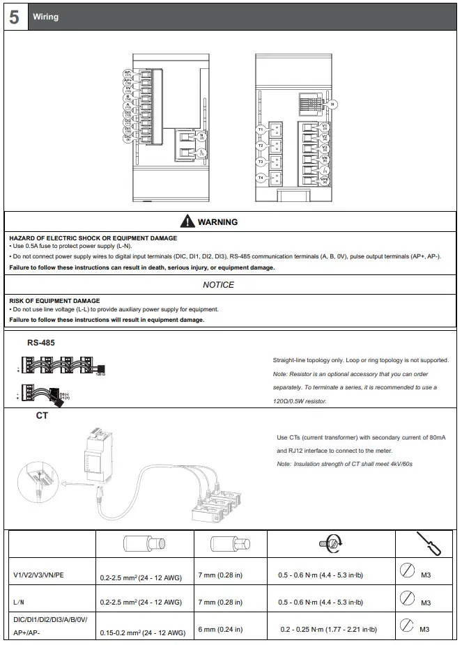
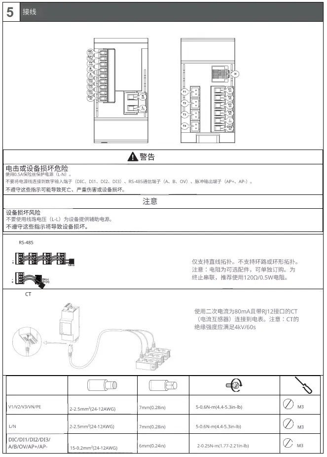
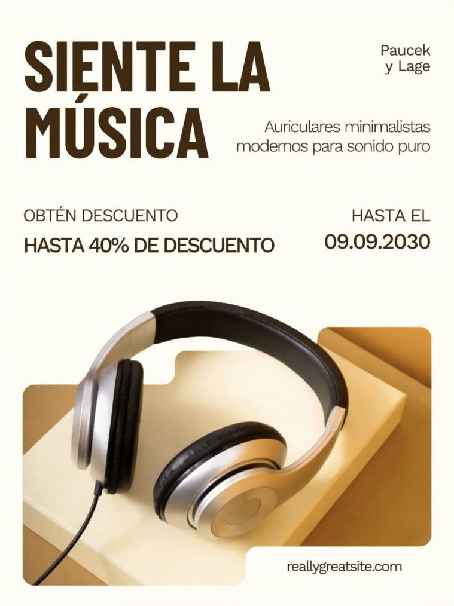

[English](README.md) · [简体中文](README.zh-CN.md) · [Español](README.es.md) · [Português (Brasil)](README.pt-BR.md)

# LingFlow — Plataforma de gestión de activos lingüísticos

**Traducción de PDF e imágenes con IA en un solo espacio de trabajo**

[LingFlow](https://lingflow.ai/es) es un espacio de trabajo online para traducir PDF y texto en imágenes, procurando conservar el diseño y organizando los originales y las traducciones en proyectos y una biblioteca central. Permite localizar documentos técnicos, imágenes de productos y material de marketing, y después previsualizar y descargar los resultados.

**[Visitar LingFlow](https://lingflow.ai/es) · [Abrir el espacio de trabajo](https://workspace.lingflow.ai/) · [Consultar precios](https://lingflow.ai/es/pricing)**

Es necesario registrarse. Los nuevos usuarios reciben **1.000 créditos de prueba**, válidos durante un mes natural desde el registro; la cuenta muestra la fecha exacta de caducidad. La prueba gratuita tiene límites de créditos y tiempo.

*Página de inicio en inglés de LingFlow, capturada el 18 de octubre de 2026.*

## Traducción de PDF, imágenes y gestión de activos

LingFlow reúne las tareas de traducción y la gestión de contenido multilingüe en un mismo espacio.

| Función | Qué permite hacer |
| --- | --- |
| Traductor de PDF con IA | Traducir documentos intentando conservar la estructura, las tablas y las ilustraciones. |
| PDF escaneados | Reconocer y traducir texto mediante OCR; la calidad depende de la claridad del escaneo. |
| Resultados PDF | Previsualizar y descargar los PDF traducidos y bilingües disponibles en los detalles de la tarea. |
| Traductor de imágenes con IA | Traducir texto en imágenes JPG/JPEG, PNG y WebP y descargar las imágenes resultantes. |
| Proyectos | Añadir archivos, configurar idiomas y seguir el progreso de las tareas. |
| Biblioteca de archivos | Buscar, filtrar, renombrar, previsualizar y descargar originales y traducciones. |

La web anuncia **más de 100 idiomas**. Las listas de idiomas para PDF e imágenes son distintas: consulta las opciones del tipo de archivo elegido. Entre los usos habituales están los documentos inglés–español, los manuales inglés–chino y las imágenes de productos chino–japonés.

## Cómo traducir PDF e imágenes con LingFlow

1. [Abre el espacio de trabajo](https://workspace.lingflow.ai/) e inicia sesión con Google o regístrate con un correo electrónico.
2. Crea un proyecto y sube archivos o selecciónalos de la biblioteca.
3. Elige los idiomas de origen y destino disponibles para cada tipo de archivo.
4. Revisa la estimación de créditos, asigna un nombre al proyecto e inicia la traducción.
5. Sigue el progreso y abre los resultados terminados para previsualizarlos.
6. Revisa términos, cifras y diseño; descarga los resultados PDF o de imagen disponibles.

La página de precios incluye la carga por lotes entre las ventajas de pago. Se pueden añadir hasta **20 archivos por lote**; las tareas se programan en segundo plano, lo que no significa que los 20 se traduzcan simultáneamente.

## Ejemplos de traducción de PDF e imágenes

Estas comparaciones muestran el diseño de documentos y contenido visual concretos. Revisa las traducciones importantes antes de publicarlas o utilizarlas.

### Traducción de un manual técnico: inglés a chino

Compara los títulos, diagramas, advertencias y la tabla de parámetros de un manual de cableado. Las instrucciones técnicas y de seguridad requieren revisión profesional antes de su uso.

| Documento técnico en inglés | Documento traducido al chino |
| --- | --- |
|  |  |

### Traducción de una imagen de marketing: inglés a español

Compara el titular, el texto promocional y la fotografía de los auriculares. La oferta forma parte del cartel y no es una promoción de LingFlow.

| Cartel de auriculares en inglés | Cartel de auriculares en español |
| --- | --- |
|  |  |

### Localización para ecommerce: chino a japonés

Compara las etiquetas, dimensiones y la tabla de especificaciones. Algunos términos sobre usos y cuidados cambian de significado; revisa el texto japonés antes de publicarlo.

*Izquierda: imagen en chino. Derecha: traducción japonesa. La disposición permite comparar y no representa un modo de exportación de imágenes.*

[Fuentes y preparación de las imágenes (en inglés)](assets/README.md)

## Prueba gratuita, créditos y límites

LingFlow utiliza créditos y ofrece una prueba limitada, pases de 30 días y paquetes de créditos permanentes.

| Concepto | Condiciones actuales |
| --- | --- |
| Prueba para nuevos usuarios | 1.000 créditos durante un mes natural desde el registro; caducidad exacta en la cuenta. |
| PDF estándar | 10 créditos por página; se factura según las páginas verificadas durante el procesamiento. |
| Traducción de imágenes | 30 créditos por tarea de traducción de imagen. |
| Tamaño de PDF | Hasta 50MB por archivo. |
| Tamaño de imágenes | Consulta el aviso actual de carga en el espacio de trabajo. |
| Tamaño del lote | Hasta 20 archivos; la carga por lotes es una ventaja de pago. |
| Pases de 30 días | Pago único; los créditos caducan 30 días después de confirmarse el pago. Sin renovación automática. |
| Paquetes de créditos | Compra única; los créditos no caducan. Sin renovación automática. |

Consulta la estimación antes de empezar. Según las preguntas frecuentes de precios, las traducciones fallidas devuelven los créditos. Consulta los [precios de LingFlow](https://lingflow.ai/es/pricing) para ver las condiciones vigentes.

## Preguntas frecuentes

### ¿LingFlow es gratis?

Los nuevos usuarios registrados reciben 1.000 créditos de prueba válidos durante un mes natural. Para continuar pueden comprar pases o paquetes de créditos.

### ¿Se conserva el formato del PDF?

LingFlow intenta conservar la estructura y el diseño. Las tablas complejas, fuentes poco habituales y escaneos de baja calidad pueden afectar al resultado; revísalo antes de usarlo.

### ¿Se pueden traducir PDF escaneados?

Sí. LingFlow admite OCR y traducción de PDF escaneados. Un escaneo claro facilita el reconocimiento; comprueba cifras, etiquetas y texto pequeño.

### ¿Puedo descargar un PDF bilingüe?

LingFlow admite resultados PDF solo traducidos y bilingües. Abre los detalles de la tarea para ver y descargar las salidas disponibles.

### ¿Puedo traducir PDF largos o lotes de archivos?

Cada PDF puede ocupar hasta 50MB. Comprueba las páginas y los créditos estimados antes de enviar documentos largos. La carga por lotes admite hasta 20 archivos, es una ventaja de pago y utiliza programación en segundo plano.

### ¿Puedo editar la imagen traducida online?

El editor integrado de imágenes aún no está disponible. Previsualiza y descarga el resultado; utiliza una herramienta externa para modificar el texto o el diseño.

### ¿Los archivos se procesan solo en mi dispositivo?

No. Se suben para procesarlos y se almacenan en la biblioteca de tu cuenta, donde puedes gestionarlos y eliminarlos. Consulta la [política de privacidad](https://lingflow.ai/es/privacy-policy).

### ¿Qué significa aquí la gestión de activos lingüísticos?

Organizar originales y traducciones en proyectos y una biblioteca central para encontrarlos, revisarlos y reutilizarlos.

## Guías, productos y ayuda

Las siguientes guías están en inglés:

- [Guía de traducción de PDF](docs/pdf-translation.md): OCR, PDF bilingües y revisión del diseño.
- [Traducción de imágenes para ecommerce](docs/image-translation-ecommerce.md): etiquetas, dimensiones y textos comerciales.
- [Espacio de trabajo, créditos y privacidad](docs/workspace-credits-privacy.md).
- [Traductor de PDF con IA](https://lingflow.ai/es/pdf-translator) · [Traductor de imágenes con IA](https://lingflow.ai/es/image-translator) · [Localización para ecommerce](https://lingflow.ai/es/ecommerce-translation)
- [Centro de ayuda de LingFlow](https://help.lingflow.ai/) · [Contacto mediante el botón Contact Us de la web](https://lingflow.ai/es)
- [Contribuir a la documentación (en inglés)](CONTRIBUTING.md)

Este es el repositorio oficial de presentación y documentación de LingFlow. El servicio está en **[lingflow.ai](https://lingflow.ai/es)**. Información verificada el **18 de octubre de 2026**; se aplican los avisos del espacio de trabajo y las condiciones de precios vigentes.
